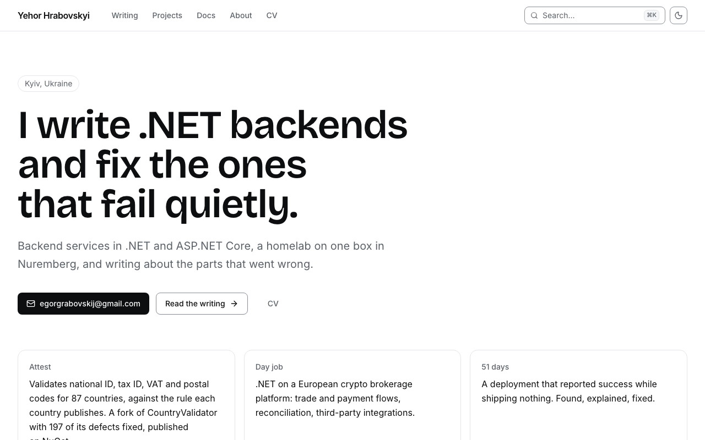
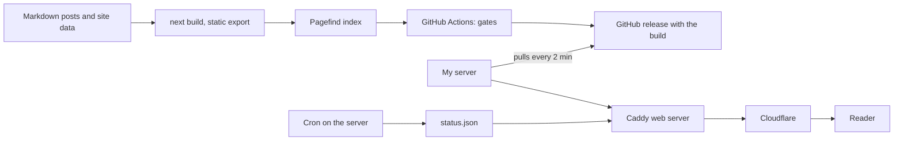

<!-- readme:header:start -->
<p>
  
  <a href="https://github.com/Egoushka/personal-website/actions/workflows/ci.yml"></a>
  
</p>
<!-- readme:header:end -->

# hrabovskyi.online

> The source of hrabovskyi.online, my portfolio and blog: a static Next.js site that I test, deploy and host myself.

<!-- readme:status:start -->
**Active**. I work on it this month.
<!-- readme:status:end -->

<picture>
  <source media="(prefers-color-scheme: dark)" srcset="docs/img/home-dark.png">
  
</picture>

## Why

I wanted one place that says what I build and shows the evidence: posts where every figure has a source, project
pages whose numbers the build computes, and docs for my tools copied from their own repositories. Hosted blog
platforms and templates give me a theme and a CMS (content management system); they don't check claims, and they
ship JavaScript to every page. So the site is plain HTML built from Markdown and data in this repository, and the
checks that keep it honest run on every pull request.

## What it does

- **Writing.** Posts in Markdown, each of a fixed kind (finding, incident, build, note), with charts and diagrams
  drawn at build time. RSS, Atom and JSON feeds.
- **Projects, CV, skills and a career timeline**, all rendered from one data file, `lib/site.ts`.
- **Docs for my tools**, written in each tool's repository and copied here at a pinned commit.
- **Search** with [Pagefind](https://pagefind.app), a static index built after the site; no search server.
- **A live panel** on the home page: aggregate numbers from my server, read from a `/status.json` that a cron job
  writes there. The page is complete without it.
- **Gates before every deploy**: content validation, type check, unit tests, assertions over the built files,
  HTTP header and redirect tests against the real web server config, browser and accessibility tests, a link check.

Not here: a CMS, a Node server in production, analytics that set cookies. Drafts are kept out of the repository
because it is public.

## Quick start

Needs Node.js 22 and npm. The first command set is what CI runs before any deploy.

```bash
git clone https://github.com/Egoushka/personal-website.git && cd personal-website
npm ci
npm run validate && npm run typecheck && npm test
npm run build && npm run check
npm run dev    # http://localhost:3000
```

`npm run serve:prod` (needs Docker) serves the build behind the production Caddy config with its real headers,
redirects and 404 pages; search works only there. [Develop](docs/how-to/develop.md) covers every command.

## How it works



Next.js builds every page to static HTML (`output: "export"`), so production has no Node runtime: redirects,
headers and the content security policy live in [deploy/Caddyfile](deploy/Caddyfile). A push to `main` runs the
gates and publishes the build as a GitHub release. My server pulls that release, checks its hash and installs it;
nothing pushes into the server, and it has no deploy key for this repository. The workflow then waits until the
live site names the new commit and tests it again.

The invariant: every page is true without JavaScript. The 15 client components only filter, enhance or add live
figures, and the static HTML holds the full content. [Deploy and hosting](docs/explanation/deploy.md) follows a
commit to the live site.

## Numbers

| | Value | Source |
|---|---|---|
| Published posts | 12 | `content/posts/` |
| Projects with docs on the site | 10 | `content/docs/sources.json` |
| Architecture decisions recorded | 10 | [docs/adr/](docs/adr/) |
| Unit test files | 16 | `tests/*.test.ts` |
| Files with `"use client"` | 15 | the table in [CLAUDE.md](CLAUDE.md) |

## Docs

- [Develop](docs/how-to/develop.md): stack, commands, project layout, adding a post
- [Deploy and hosting](docs/explanation/deploy.md): the deploy pipeline, Cloudflare, `/status.json`, prelive
- [The post framework](docs/writing/README.md): kinds, skeletons, the evidence pack
- [Project docs contract](docs/project-docs.md): what a tool's docs must look like to be copied here
- [Design brief](docs/DESIGN-BRIEF.md) · [Comments backend](docs/comments-backend.md) ·
  [SMTP setup](docs/SETUP-SMTP.md) · [Search Console setup](docs/SETUP-SEARCH-CONSOLE.md)
- [Architecture decisions](docs/adr/)

## License

The code is Apache-2.0 ([LICENSE](LICENSE)). The posts, the personal content in `lib/site.ts` and the images are
not: all rights reserved, see [NOTICE](NOTICE).

<!-- readme:footer:start -->
---

<sub>Made by [Yehor Hrabovskyi](https://hrabovskyi.online) · [Apache licence](LICENSE).</sub>
<!-- readme:footer:end -->
